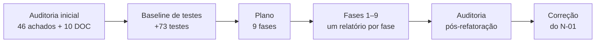

# HelpDesk Lite — Relatório de Modernização

**Atividade:** Auditoria e Refatoração de Arquitetura
**Sistema:** HelpDesk Lite (MVP de chamados internos: TI, Facilities, RH)
**Período:** 30/09/2026 a 01/10/2026

| Item | Valor |
|---|---|
| Estado inicial ("antes") | Branch `main`, commit `c5f4335`: o MVP entregue, inalterado durante todo o trabalho |
| Estado final ("depois") | Branch `refactoring`, criada a partir de `c5f4335`. As alterações estão no diretório de trabalho, **sem commits**: nenhum commit foi solicitado durante a atividade |
| Fontes deste relatório | Auditoria inicial (doc. 01), baseline de testes (doc. 02), plano de modernização (doc. 03), relatórios de execução das Fases 1 a 9, auditoria pós-refatoração (doc. 05) e relatório da correção pós-auditoria do N-01. Lista na §13 |
| Regra de evidência | Todo número aqui foi **medido** em alguma dessas etapas, e a tabela indica quando. Não há percentuais de melhoria calculados nem benefícios estimados. Quando um valor foi calculado e não medido, isso está dito |

---

## 1. Resumo

O HelpDesk Lite é um monolito em camadas: Spring Boot 3.3.5 com Java 21 e H2 no backend, Vue 3
com Quasar 2 e Pinia no frontend. A auditoria inicial registrou **46 achados** (9 de
severidade Alta, 16 Média e 21 Baixa) e **10 divergências** entre documentação e código. Os
mais graves, todos reproduzidos em execução:

- erros do próprio cliente respondidos com **500**;
- regras de negócio que permitiam deixar o sistema **sem nenhum administrador** e chamados com
  atendente inválido;
- ausência de controle de concorrência na assunção de chamados;
- configuração padrão que expunha endpoints sensíveis e dados pessoais;
- **N+1** na listagem paginada;
- modelo de domínio anêmico;
- a camada de serviço dependendo da camada web.

A modernização seguiu um plano em nove fases, com uma regra central: **correção e refatoração
nunca juntas**. Uma correção troca um teste que fixava o defeito por um teste de contrato. Uma
refatoração não pode editar nenhum teste de contrato ou de integração.

Depois das nove fases, uma auditoria pós-refatoração mediu de novo os dois estados com as mesmas
ferramentas. Ela confirmou as correções e encontrou **problemas novos**. O principal, o **N-01**
(a guarda do "último administrador" violável sob concorrência), foi corrigido numa etapa
posterior.

**Resultado final** (todos os valores medidos):

| Indicador | Antes (`main`) | Depois (final) |
|---|---|---|
| Testes de backend | 151 | **302**, 0 falhas |
| Testes de frontend | 49 | **86**, 0 falhas |
| Testes que fixavam defeito conhecido | 21 (criados na baseline) | **0** |
| Funções com complexidade ciclomática > 10 | 1 (CCN 12) | **0** |

| Destino dos 46 achados iniciais | Quantidade |
|---|:---:|
| Corrigidos | 24 |
| Mitigados | 11 |
| Reclassificados por decisão arquitetural | 1 |
| Mantidos como dívida técnica | 9 |
| Fora do escopo | 1 |

**A modernização não eliminou toda a dívida técnica.** Restam 21 itens identificados (§11).
Seis deles são de severidade Média, entre eles entidades ainda anêmicas, exceções sem
hierarquia, o dashboard carregando todos os chamados em memória e regras de transição
espelhadas no frontend.

---

## 2. Estado inicial do sistema

### 2.1 Contexto

| Aspecto | Situação em `c5f4335` |
|---|---|
| Arquitetura declarada | Monolito em camadas, `web → service → domain ← repository` (ADR-002) |
| Backend | 58 classes em `src/main`; Spring Web, Spring Data JPA, Bean Validation, Actuator + Micrometer, springdoc; H2 em memória com seed |
| Frontend | SPA Vue 3 + Quasar 2, Pinia, Axios; 31 arquivos `.js`/`.vue` em `src` |
| Autenticação | Simulada pelo header `X-User-Id` (ADR-003, decisão consciente do MVP) |
| Documentação | `docs/ARQUITETURA.md` (ADRs 001–013) e `.ai/` (ADRs 014–018, regras de negócio e padrões): duas fontes de verdade |

### 2.2 Medições iniciais

| Métrica | Valor | Onde foi medido |
|---|---|---|
| Testes de backend / frontend | 151 / 49 (4 arquivos), todos passando | Auditoria inicial |
| Cobertura de linhas do backend (JaCoCo) | 92,1% no total; 95,0% em `domain` + `service`; `web.controller` 50,0%; `domain.model` 17,4% | Auditoria inicial |
| Funções analisadas (lizard 1.24.0; Java, JS e Vue, sem testes) | 247, CCN médio 1,74 | Auditoria inicial; reproduzido na auditoria pós-refatoração |
| Funções com CCN > 10 | 1: `ChamadoAcoes.vue`, computed `acoes`, CCN 12 | Idem |
| Maior CCN do backend | 6 | Idem |
| Taxa de duplicação (lizard `-Eduplicate`) | 9,88% (20 blocos) | Auditoria pós-refatoração, sobre a `main` |
| Imports `service → web` | 17 | Auditoria inicial; reproduzido na auditoria pós-refatoração |
| Consultas SQL em `GET /api/chamados?size=20` (seed, admin) | 9 | Idem |
| Erros de cliente que respondiam 500 | 4 (rota inexistente, 405, 415, `sort` inválido), cada um com linha `ERROR` e *stack trace* | Idem |
| `/actuator/env` e `/actuator/loggers` com `java -jar` sem perfil | 200 e 200 | Idem |

### 2.3 Pontos fortes registrados

A auditoria inicial registrou o que a modernização não podia perder:

- a ordem fixa "permissão (403) antes da transição (422)";
- a visibilidade do solicitante aplicada no `WHERE`, sem vazamento no `count`;
- o `Clock` injetado;
- a máquina de estados como tabela (`TransicaoStatus`);
- o formato único de erro com `X-Request-Id` de ponta a ponta;
- *builders* de teste em vez do seed;
- `open-in-view: false`.

A auditoria pós-refatoração verificou que todos continuam presentes (§7.3).

---

## 3. Metodologia

### 3.1 Etapas



| Etapa | O que produziu |
|---|---|
| 1. Auditoria técnica | Achados por área: arquitetura, domínio/SOLID, regras, exceções, segurança, concorrência, observabilidade, frontend, testes e documentação. Cada um com evidência **[confirmado]** (reproduzido contra o jar em execução) ou **[por inspeção]** |
| 2. Baseline de caracterização | +73 testes (51 de backend, 22 de frontend), sem tocar em `src/main`. Desses, **21 fixavam defeitos conhecidos** (17 no backend, 4 no frontend), marcados com `[DEFEITO CONHECIDO]` e, no backend, isolados com `@Tag("defeito-conhecido")`; **52 protegiam contrato**. Totais: 202 testes de backend e 71 de frontend, todos passando |
| 3. Plano | Classificação de cada achado em necessário ou opcional, a técnica de refatoração de cada um, a ordem das fases e os riscos |
| 4. Execução (Fases 1–9) | Uma fase por vez, com as duas suítes completas ao fim de cada uma e um relatório com o que mudou, os testes substituídos e a validação |
| 5. Auditoria pós-refatoração | Os mesmos critérios e ferramentas da auditoria inicial, aplicados **aos dois estados no mesmo dia**: a `main` extraída com `git archive`, compilada e executada fora do repositório |
| 6. Correção pós-auditoria | Correção pontual do N-01, com testes escritos e executados contra o código anterior antes da correção |

### 3.2 Princípios aplicados na execução

1. **Correção (`fix`) e refatoração (`refactor`) separadas.**
   - Numa correção, o teste `[DEFEITO CONHECIDO]` correspondente é removido e substituído por um
     teste de contrato com o comportamento correto. Nunca é ajustado silenciosamente.
   - Numa refatoração, nenhum teste de contrato ou de integração é editado.
2. **Sem funcionalidade nova, sem dependência nova, sem reescrita.** Achados que só se
   resolveriam com funcionalidade nova ficaram registrados como decisão do grupo (§5.3).
3. **Contrato REST preservado**, exceto nas correções planejadas (códigos de erro e dados
   expostos), cada uma coberta por teste de contrato.
4. **`main` intocada.** Todo o trabalho foi feito na branch `refactoring`.

### 3.3 Instrumentos de medição

| Medição | Instrumento |
|---|---|
| Testes e cobertura | `./mvnw verify` (JUnit 5 + JaCoCo, com os relatórios do Surefire apagados antes de contar) e `npx vitest run` |
| Complexidade ciclomática e duplicação | lizard 1.24.0, instalado fora do repositório; Java, JS e Vue; testes excluídos |
| Dependências entre camadas | Script que lê os `import br.com.helpdesk.*` de `src/main`; no build, `DependenciaEntreCamadasTest` (7 regras) |
| Consultas por requisição | Log `org.hibernate.SQL` do perfil `dev`, filtrado pelo `X-Request-Id`, e `ConsultasPorRequisicaoIT` nos testes |
| Comportamento HTTP | `curl` contra o jar em execução, nos perfis sem perfil, `dev` e `prod` |
| Concorrência | Requisições paralelas contra o jar e testes de integração com intercalação controlada |
| *Smells* | `grep` por padrão: setters, comparações de perfil, `Instant.now()`, `catch` vazio etc. |

### 3.4 Critérios de classificação do destino dos achados

| Destino | Critério |
|---|---|
| **Corrigido** | O problema deixou de existir, com evidência medida ou testada |
| **Mitigado** | A parte principal foi tratada e resta uma parte identificada e descrita |
| **Reclassificado** | O comportamento foi mantido por uma decisão arquitetural registrada (ADR) |
| **Dívida técnica** | O problema continua, sem decisão de mantê-lo assim |
| **Fora do escopo** | Só se resolveria com funcionalidade nova, excluída da atividade |

---

## 4. Principais problemas encontrados

### 4.1 Distribuição

| Área | Achados | Alta | Média | Baixa |
|---|:---:|:---:|:---:|:---:|
| Arquitetura (ARQ) | 4 | — | 3 | 1 |
| Domínio, OO e SOLID (DOM) | 6 | 1 | 2 | 3 |
| Regras de negócio (REG) | 6 | 2 | 2 | 2 |
| Exceções (EXC) | 4 | 1 | 2 | 1 |
| Segurança e configuração (SEG) | 8 | 3 | 1 | 4 |
| Concorrência e persistência (CON) | 5 | 2 | 2 | 1 |
| Observabilidade (OBS) | 3 | — | 1 | 2 |
| Frontend (FE) | 7 | — | 2 | 5 |
| Testes (TST) | 3 | — | 1 | 2 |
| **Total** | **46** | **9** | **16** | **21** |

Somam-se a elas 10 divergências entre documentação e código (DOC-01 a DOC-10), como ADRs
divididas em dois documentos e uma regra de dependência descrita, mas violada.

### 4.2 Os nove achados de severidade Alta

| ID | Problema | Evidência na auditoria inicial |
|---|---|---|
| EXC-01 | Rota inexistente, método não suportado, `Content-Type` errado e `sort` inválido respondiam 500 | [confirmado]: 4 × 500 com *stack trace* em `ERROR` |
| REG-01 | O único admin podia se rebaixar e deixar o sistema sem administrador, de forma irrecuperável | [confirmado]: `PUT` 200, depois `GET /api/usuarios` 403 |
| REG-02 | Um atendente com chamado em andamento podia ser rebaixado, deixando o chamado órfão (invariante I3) | [confirmado] |
| CON-01 | Sem *lock* otimista: duas assunções simultâneas do mesmo chamado terminavam as duas com 200 | [por inspeção]; reproduzido na auditoria pós-refatoração (§8.8) |
| SEG-02 | O perfil padrão era `dev`: `java -jar` sem perfil expunha `/actuator/env`, `/actuator/loggers`, console H2 e Swagger | [confirmado] |
| DOM-01 | Modelo anêmico: estado do chamado alterado por setters públicos a partir do service | [por inspeção] |
| SEG-01 | Personificação por `X-User-Id` ativa também no perfil `prod` | [confirmado] (o mecanismo em si é aceito no MVP pela ADR-003) |
| CON-03 | N+1 na listagem paginada | [confirmado]: 9 consultas para 8 chamados |
| SEG-03 | Endpoint público listava todos os usuários com e-mail | [confirmado] |

---

## 5. Decisões de modernização

### 5.1 Classificação e ordem

O plano classificou **25 itens como correção necessária** e **21 como melhoria opcional**,
contando DOC-01…10 como um item e o par REG-06/REG-07 como outro. Além disso, deixou **4 temas
fora do escopo**. A ordem das fases seguiu dependências técnicas:

| Fase | Área | Natureza | Por que nesta posição |
|:---:|---|---|---|
| 1 | Tratamento de exceções | Correção | Base para os 409 e 401 das fases seguintes |
| 2 | Regras de negócio e concorrência | Correção | Antes da Fase 5, que remove os setters usados pelo teste de defeito do CON-01 |
| 3 | Segurança e configuração | Correção | Depende só da Fase 1 |
| 4 | Persistência e desempenho | Correção (+ opcionais) | Depende só da Fase 1 |
| 5 | Domínio, OO e SOLID | Refatoração | Parte de uma base já correta |
| 6 | Arquitetura em camadas | Refatoração | Depois do domínio, para não mexer duas vezes nas assinaturas dos services |
| 7 | Frontend | Correção + refatoração | Depende só do contrato HTTP |
| 8 | Observabilidade | Correção + opcionais | Mais simples com os efeitos da transição já no agregado |
| 9 | Limpeza e documentação | Opcionais + documentação | A documentação descreve o código final |

### 5.2 Decisões arquiteturais registradas

As decisões da modernização foram registradas como ADRs 019 a 024, somadas às 18 originais. O
texto integral está em `.ai/architecture.md` e o índice em `docs/ARQUITETURA.md` §4.7.

| ADR | Decisão | Alternativa descartada |
|---|---|---|
| 019 | Erros do Spring MVC no handler central; conflitos como 409 `CONFLITO`; login com 401 | Um `@ExceptionHandler` por exceção; manter o 500 |
| 020 | *Optimistic locking* (`@Version`) no `Chamado`; guardas das invariantes I3/I11. **Revisada na correção do N-01:** as guardas passaram a travar as linhas de `usuario` envolvidas | *Lock* pessimista na assunção; nenhuma proteção |
| 021 | Configuração base fechada; perfil `dev` explícito; `prod` recusa subir com o login simulado | Manter `dev` como padrão |
| 022 | `Chamado` como agregado com comportamento; permissão e SLA no pacote `domain`, sem Spring | Manter setters; entidades como `record` (incompatível com JPA) |
| 023 | Entradas e saídas dos services em `service.dto`; dependência entre camadas verificada por teste | ArchUnit (dependência nova) |
| 024 | Métricas e auditoria emitidas só depois do commit | Emitir dentro da transação |

**Reclassificação por decisão arquitetural:** OBS-01 ("os gauges só atualizam quando alguém
abre o dashboard") é a consequência registrada na ADR-018. Na Fase 8 essa ADR foi reavaliada e
**mantida**, porque o MVP não tem Prometheus configurado e as alternativas trariam um agendador
ou consultas a cada coleta. O teste que fixava o comportamento como defeito virou teste de
contrato.

### 5.3 Fora do escopo (decisão do grupo)

Exigiriam funcionalidade nova. Em cada caso foi feita a parte corretiva:

| Tema | O que foi feito | O que ficaria para depois |
|---|---|---|
| Autenticação real | `prod` não sobe com o login simulado; a configuração sem perfil também o desliga | Spring Security + JWT/OIDC |
| Reativação de cadastros (REG-03) | O comentário que prometia a reativação foi corrigido; o contrato "`PUT` não reativa" é testado | Rotas de reativação |
| Reatribuição de chamado | As guardas impedem o chamado órfão | Rota para o admin trocar o atendente |
| `acoesPermitidas` na API | Tabela declarativa no frontend, coberta por 18 testes | O backend calcularia as ações |

### 5.4 Desvios do plano

| Previsto | Executado | Motivo |
|---|---|---|
| "Um achado por commit" | Nenhum commit | Não foram solicitados commits durante a atividade. As alterações estão no diretório de trabalho da branch `refactoring` |
| ADRs consolidadas numa pasta `docs/adr/` | Texto único em `.ai/architecture.md`; índice em `docs/ARQUITETURA.md` | O problema registrado (DOC-02) era haver duas fontes. Uma pasta nova criaria a terceira |

---

## 6. Refatorações realizadas

| Fase | Achados tratados | Principais alterações | Testes de backend / frontend ao fim |
|:---:|---|---|---|
| Baseline | TST-01 | +73 testes de caracterização (21 de defeito, 52 de contrato) | 202 / 71 |
| 1 | EXC-01, REG-04, SEG-06, CON-02 (parte) | `GlobalExceptionHandler` estende `ResponseEntityExceptionHandler` (404/405/415/400); `NaoAutenticadoException` (401 uniforme no login e no filtro); 409 para violação de integridade e conflito de versão | 213 / 71 |
| 2 | REG-01, REG-02, CON-01 | Guardas "ao menos um admin ativo" e "atendente com chamados em andamento" no `UsuarioService`; `@Version` no `Chamado` | 233 / 71 |
| 3 | SEG-01 (parte mínima), SEG-02, SEG-03, SEG-04, TST-02 | Configuração base fechada; `dev` ativado pelo `spring-boot:run`; `env`/`loggers` fora de todos os perfis; `EnvironmentPostProcessor` que impede `prod` com login simulado; rotas públicas sem e-mail; e-mail fora dos logs | 251 / 71 |
| 4 | CON-03, CON-06 (novo), REG-05, CON-05 | `@EntityGraph` na listagem paginada e nos comentários; consulta só para log removida; sequências do seed recalculadas a partir dos dados (`RESTART WITH (SELECT MAX(id)+1 ...)`) | 262 / 71 |
| 5 | DOM-01, DOM-02, DOM-03, ARQ-03; opcionais DOM-04, ARQ-02, ARQ-04 | `Chamado` com `abrir`/`assumir`/`alterarStatus`, sem setters; `Comentario.registrar`; capacidades no enum `Perfil`; `PermissaoService` e `SlaCalculator` movidos para `domain.permissao`/`domain.sla`; `SituacaoSla` | 280 / 71 |
| 6 | ARQ-01 | `*Response` e `Dados*` em `service.dto`; `paraDados()` nos requests; `DependenciaEntreCamadasTest` | 287 / 71 |
| 7 | FE-01, FE-02, FE-04, EXC-03; opcional SEG-08 | `ChamadoAcoes` declarativo (CCN 12 → 3) com prop `processando` contra clique duplo; `catalogoStore` com listas e carregamentos separados; 401 encerra a sessão; `boot/sessao.js` revalida a sessão | 287 / 86 |
| 8 | OBS-02, nome do timer; OBS-01 reclassificado | `AposCommit`: contadores, timer e auditoria só depois do commit; timer exposto como `helpdesk_tempo_resolucao_seconds` | 291 / 86 |
| 9 | REG-03, DOC-01…10; opcionais DOM-05, REG-06/07, FE-03, FE-05 | Código morto removido; normalização sem duplicação; constantes e formatação únicas no frontend; documentação reconciliada com o código; ADRs 019–024; `UsuarioAtual` fora da especificação OpenAPI | 291 / 86 |
| Pós-auditoria | N-01 (REG-01 e REG-02 sob concorrência) | Trava de linha (`SELECT ... FOR UPDATE`) em ordem fixa sobre os usuários envolvidos; `assumir` decide pelo usuário gravado; trava não obtida a tempo → 409 | **302 / 86** |

Ao longo das fases, os **21 testes `[DEFEITO CONHECIDO]`** foram substituídos por testes de
contrato à medida que cada defeito foi tratado. O último, do REG-03, saiu na Fase 9.

---

## 7. Auditoria pós-refatoração e correção do N-01

### 7.1 Problemas encontrados pela auditoria pós-refatoração

A auditoria refez as medições da auditoria inicial sobre os dois estados. Além de confirmar as
correções, ela registrou problemas que **as próprias refatorações introduziram ou não
resolveram**:

| ID | Sev. | Problema | Situação final |
|---|---|---|---|
| **N-01** | Média | A guarda do REG-01 contava os admins e depois gravava, sem trava. Dois admins que rebaixavam um ao outro ao mesmo tempo passavam os dois, e o sistema ficava **sem administrador**. Reproduzido contra o jar na 1ª tentativa | **Corrigido** (§7.2) |
| N-02 | Baixa | Ciclo `web ↔ config`: dois imports novos de `web` para `config`, que o teste de arquitetura não cobre | Dívida técnica |
| N-03 | Baixa | A guarda nova usa `== Perfil.ADMIN`, contra a pergunta por capacidade adotada no DOM-03 | Dívida técnica |
| N-04 | Baixa | `@Builder` público em `Chamado`/`Comentario`, usado só por testes, permite montar estados que o agregado impede | Dívida técnica |
| N-05 | Observação | Classes maiores: `UsuarioService` 119 → 221 linhas, `Chamado` 114 → 226, `GlobalExceptionHandler` 109 → 230 (com Javadoc). Nenhum método do backend passa de CCN 7 | — |
| N-06 | Baixa | Aviso do Spring Data sobre a serialização direta de `PageImpl`. **Já existia** na `main`, mas não constava da auditoria inicial | Dívida técnica |
| N-07 | Baixa | `ARQUITETURA.md` §4.12 descreve todos os testes de integração como transacionais, o que deixou de ser verdade | Dívida técnica |
| N-08 | Processo | O relatório da Fase 9 afirmou "nenhuma função acima de CCN 10" sem a ferramenta ter rodado (o lizard não estava no `PATH` e o erro foi suprimido). A auditoria mediu e confirmou o resultado, e o relatório foi corrigido | Registrado |

A mesma auditoria não encontrou **regressões de comportamento**. As sondas HTTP mostraram só as
mudanças planejadas, e os pontos fortes da §2.3 continuam presentes.

### 7.2 Correção do N-01

| Item | Descrição |
|---|---|
| Causa | *Write skew*. As guardas de I11 (último admin) e I3 (atendente com chamados) leem e gravam linhas **diferentes**, então nenhuma trava de versão as faz conflitar |
| Alcance comprovado | Seis testes escritos **antes** da correção falharam no código anterior. Entre os resultados: 0 admins ativos; atendente rebaixado com chamado em atendimento; chamado assumido por usuário rebaixado ou desativado. A corrida também afetava o REG-02 e foi tratada junto |
| Solução | `SELECT ... FOR UPDATE` sobre os admins ativos (por id) e depois o usuário alterado, em `atualizar` e `desativar`. O `assumir` trava a linha do atendente antes de ler o chamado e decide pelo usuário gravado. A requisição concorrente espera e recebe a resposta da regra (422, 403 ou 401); uma trava não obtida dentro do limite do banco vira 409 `CONFLITO`. Sem mudança de schema |
| Testes | `ConcorrenciaUsuarioIT` (6 testes). A intercalação é controlada pelo próprio banco (sessão bloqueada em `INFORMATION_SCHEMA.SESSIONS`), sem `sleep`; a classe passou em 10 execuções seguidas. Mais 4 testes unitários e 1 de web |
| Verificação empírica | O mesmo roteiro da auditoria em 20 tentativas pela API: sempre exatamente uma resposta 200 (16 × 200/422, 2 × 422/200, 2 × 200/403), nunca sem admin, 0 linhas `ERROR` |
| Custo medido | `PATCH /api/chamados/{id}/assumir`: 4 → 5 comandos SQL. O `ChamadoService` passou de 9 para 10 dependências injetadas, o que agrava o DOM-06, mantido como dívida |

### 7.3 Pontos fortes preservados

Verificados na auditoria pós-refatoração:
- ordem 403 → 422, coberta por teste unitário e de integração;
- visibilidade no `WHERE`: a listagem do solicitante usa 2 consultas e o `count` não vaza
  chamados de terceiros;
- `Clock` injetado;
- `TransicaoStatus` como tabela;
- formato único de erro com `X-Request-Id`;
- *builders* de teste;
- `open-in-view: false`.

---

## 8. Comparativo técnico Antes × Depois

A coluna "Medição" indica quando o valor foi obtido:
- **AI**: auditoria inicial;
- **BL**: baseline de testes;
- **F4**: Fase 4;
- **AP**: auditoria pós-refatoração (antes da correção do N-01; os dois lados medidos no mesmo dia);
- **CN**: depois da correção do N-01 (estado final).

### 8.1 Testes

| Métrica | Antes | Depois | Medição |
|---|---|---|---|
| Testes de backend | 151 | **302**, 0 falhas, 0 erros, 0 ignorados | AI / CN |
| Testes de frontend | 49 (4 arquivos) | **86** (9 arquivos), 0 falhas | AI / CN |
| Testes `[DEFEITO CONHECIDO]` | 21 (BL) | **0**; `-Dgroups=defeito-conhecido` executa 0 testes | BL / CN |
| Build de produção do frontend (`quasar build`) | — | Sucesso | CN |

### 8.2 Cobertura do backend (JaCoCo)

| Métrica | Antes | Depois | Medição |
|---|---|---|---|
| Linhas, total | 92,1% (151 testes); 95,4% com a baseline (202 testes) | **98,0%** (669/683) | AI e BL / CN |
| *Branches*, total | 67,1% (202 testes; não medido antes da baseline) | **79,7%** | BL / CN |
| Linhas em `domain` + `service` (gate ≥ 80%) | 95,0% | **97,7%**; gate aprovado | AI / CN |
| `web.controller` | 50,0% | 100% | AI / AP |
| `web.exception` | 80,6% | 100% | AI / AP |
| `domain.model` | 17,4% | 82,1% | AI / AP |

### 8.3 Complexidade ciclomática (lizard 1.24.0)

| Métrica | Antes | Depois | Medição |
|---|---|---|---|
| Funções analisadas | 247 | 284 | AP / CN |
| CCN médio | 1,74 | 1,70 | AP / CN |
| **Funções com CCN > 10** | **1** (`ChamadoAcoes.vue`, `acoes`, CCN 12) | **0** | AP / CN |
| Maior CCN | 12 | 10 (`services/chamados.js` `listar`, igual na `main`) | AP / CN |
| Maior CCN do backend | 6 | 7 | AP / CN |
| Maior CCN em `ChamadoAcoes.vue` | 12 | 3 | AP / CN |

Algumas funções ficaram mais complexas, todas ≤ 10. Exemplos medidos na AP:
- interceptor de resposta do `api.js`: 5 → 8 (tratamento do 401);
- `PermissaoService.verificarAlteracaoStatus`: 6 → 7;
- `UsuarioAtualFilter.doFilterInternal`: 5 → 6.

### 8.4 Duplicação (lizard `-Eduplicate`)

| Métrica | Antes | Depois | Medição |
|---|---|---|---|
| Taxa de duplicação | 9,88% | 6,77% | AP / CN |
| Blocos duplicados | 20 | 14 | AP / CN |

Os blocos restantes são cabeçalhos de `import` e anotações repetidos entre controllers. A
duplicação de constantes do frontend, que o lizard não detecta em `.vue`, foi medida por
`grep` (§8.6).

### 8.5 Dependências entre camadas (imports de `br.com.helpdesk.*` em `src/main`)

| Origem → destino | Antes | Depois | Medição |
|---|:---:|:---:|---|
| `service → web` | **17** | **0** | AP / CN |
| `domain →` qualquer outra camada | 0 | 0 | AP / CN |
| Arquivos de `domain` que importam Spring | 0 | 0 | AP / CN |
| `web → repository` | 1 (filtro do login) | 1 (o mesmo, exceção documentada) | AP / CN |
| `web → config` | 0 | 2 (N-02) | AP / CN |
| Classes em `src/main` | 58 | 65 | AP / CN |
| Regras verificadas no build | 0 | 7 (`DependenciaEntreCamadasTest`) | CN |

### 8.6 Indicadores de *code smell* (contagem por `grep`)

| Indicador | Antes | Depois | Medição |
|---|:---:|:---:|---|
| Chamadas `set*` de estado do chamado fora do domínio | 9 | 0 | AP / CN |
| Entidades com `@Setter` | 4 | 2 (`Usuario`, `Categoria`) | AP / CN |
| Comparações `== Perfil.X` no backend | 11 | 3 (N-03) | AP / CN |
| Comparações com literal de perfil no frontend | 10 | 4 | AP / CN |
| `Instant.now()` fora do `Clock` | 2 | 2 (EXC-04) | AP / CN |
| `.catch(() => {})` no frontend | 10 | 12 (padrão adotado na Fase 7) | AP / CN |
| Cópias da formatação de data no frontend | 4 | 1 | AP / CN |
| *Fallback* da URL do backend | 2 | 1 | AP / CN |
| Dependências injetadas no `ChamadoService` | 9 | 10 | AP / CN |
| Métodos públicos sem uso em `src/main` | 9 símbolos | 1 (`TransicaoStatus.permitida`, oráculo dos testes, mantido de propósito) | AI / AP |

### 8.7 Comportamento HTTP (sondas contra o jar)

| Requisição | Antes | Depois | Medição |
|---|:---:|:---:|---|
| `GET /api/nao-existe` | 500 | 404 | AP |
| `DELETE /api/chamados/1` (método não mapeado) | 500 | 405 | AP |
| `POST /api/chamados` com `text/plain` | 500 | 415 | AP |
| `GET /api/chamados?sort=naoExiste,asc` | 500 | 400 | AP |
| Linhas `ERROR` geradas por essas quatro sondas | 4 | 0 | AP |
| `POST /api/auth/login` com id inexistente | 404 | 401, mensagem única | AP |
| `/actuator/env`, `/actuator/loggers` sem perfil | 200, 200 | 404, 404 | AP |
| Console H2 e Swagger sem perfil | 302, 302 | 404, 404 | AP |
| Rota pública de usuários do login | Com e-mail | Sem e-mail | AP |
| `prod` com login simulado ligado | Sobe | Não sobe (exit 1) | AP |
| Rebaixar o único admin / atendente com chamado em andamento | 200 / 200 | 422 / 422 | AI / AP |
| E-mail em logs `INFO`/`WARN`/`ERROR` | Sim | 0 ocorrências | AI / AP |

### 8.8 Consultas por requisição e concorrência

| Medição | Antes | Depois | Medição |
|---|:---:|:---:|---|
| `GET /api/chamados?size=20` (admin) | 9 | 2 | AP |
| `GET /api/chamados` (solicitante) | 7 | 2 | AP |
| `GET /api/chamados?size=3&page=1` (página cheia, com `count`) | 8 | 3 | AP |
| Página cheia com 60 entidades relacionadas distintas | 63 (**calculado**, não medido) | 3 | F4 |
| `GET /api/chamados/4` (detalhe) e `.../comentarios` | 3 e 3 | 3 e 3 | AP |
| `GET /api/dashboard/resumo` | 2 | 2 | AP |
| `PATCH /api/chamados/{id}/assumir` | 4 | 5 (trava do N-01) | AP / CN |
| 15 corridas de duas assunções simultâneas do mesmo chamado | 4 corridas com **duas** respostas 200 | Exatamente uma 200 por corrida; o perdedor recebe 409 ou 422 | AP |
| Dois admins rebaixando um ao outro ao mesmo tempo | Sem admin na 1ª tentativa (código da Fase 9) | 20 tentativas, sempre uma única 200, nunca sem admin | AP / CN |

---

## 9. Destino dos 46 achados iniciais

### 9.1 Resumo

| Destino | Qtde | Achados |
|---|:---:|---|
| **Corrigido** | **24** | ARQ-01, ARQ-02, DOM-05, REG-01, REG-02, REG-04, REG-05, REG-06, EXC-01, SEG-02, SEG-03, SEG-04, SEG-06, SEG-08, CON-01, CON-02, CON-03, CON-05, FE-02, FE-03, FE-04, FE-05, TST-01, TST-02 |
| **Mitigado** | **11** | ARQ-03, ARQ-04, DOM-01, DOM-02, DOM-03, DOM-04, EXC-03, SEG-01, OBS-02, FE-01, TST-03 |
| **Reclassificado** (decisão arquitetural) | **1** | OBS-01 (ADR-018) |
| **Dívida técnica** | **9** | DOM-06, EXC-02, EXC-04, SEG-05, SEG-07, CON-04, OBS-03, FE-06, FE-07 |
| **Fora do escopo** | **1** | REG-03 (reativação de cadastros) |
| **Total** | **46** | |

As 10 divergências de documentação (DOC-01…10) foram corrigidas na Fase 9. A auditoria
pós-refatoração encontrou uma divergência nova (N-07), que segue como dívida.

**Severidade Alta (9):**
- **corrigidos (7):** EXC-01, REG-01, REG-02, CON-01, CON-03, SEG-02 e SEG-03. REG-01 e
  REG-02 só ficaram seguros sob concorrência depois da correção do N-01;
- **mitigados (2):** DOM-01 (`Usuario` e `Categoria` continuam anêmicos) e SEG-01 (corrigido
  até o limite do escopo; a personificação em `dev`/`test` é o mecanismo aceito do MVP).

### 9.2 O que resta em cada achado mitigado

| ID | Tratado | Resíduo |
|---|---|---|
| ARQ-03 | Três implementações da regra de visibilidade viraram duas, que fazem a mesma pergunta de capacidade | Predicado SQL e checagem em memória continuam separados |
| ARQ-04 | SLA avaliado uma vez por chamado (`SituacaoSla`) | O mapper ainda depende do `SlaCalculator` |
| DOM-01 | `Chamado` e `Comentario` sem setters, com métodos de intenção | `Usuario` e `Categoria` com setters e construtores públicos |
| DOM-02 | Tabela e efeitos das transições no domínio | Efeito num `switch` separado da aresta; frontend com cópia declarada da tabela |
| DOM-03 | Capacidades no enum `Perfil` | 3 comparações de identidade no backend (N-03) e 4 no frontend |
| DOM-04 | Parâmetro morto removido | `verificarAbertura` com corpo vazio, por decisão registrada |
| EXC-03 | 401 encerra a sessão; erros não escapam mais como *unhandled rejection* | Tratamento por `.catch(() => {})` em cada página (12) |
| SEG-01 | `prod` e a configuração sem perfil sem login simulado | Autenticação real fora do escopo |
| OBS-02 | Métricas e auditoria só do que foi confirmado | Nova medição a cada resolução de chamado reaberto; tag `categoria` pelo nome |
| FE-01 | CCN 12 → 3, tabela declarativa | A tabela espelha o backend à mão |
| TST-03 | Testes de `api.js`, `catalogoStore`, boot e uma página | Sem métrica de cobertura no frontend (exigiria dependência nova) |

---

## 10. Mudanças de comportamento visíveis ao cliente

Todas planejadas e cobertas por testes de contrato.

| Antes | Depois | Origem |
|---|---|---|
| Erros do cliente (rota, método, mídia, JSON, ordenação) → 500 | 404, 405, 415, 400 no formato padrão de erro | Fase 1 |
| Violação de integridade → 500 | 409 `CONFLITO`, sem a mensagem do banco | Fase 1 |
| Login: inexistente → 404, inativo → 422; 401 com mensagem reveladora | 401 com mensagem única | Fase 1 |
| Último admin rebaixável; atendente com chamado rebaixável | 422 `REGRA_NEGOCIO` | Fase 2 |
| Duas assunções simultâneas → duas 200 | Uma 200; o perdedor recebe 409 ou 422 | Fase 2 |
| Rebaixamentos ou desativações concorrentes violando I3/I11 | A segunda requisição espera e recebe 422, 403 ou 401; trava não obtida a tempo → 409 | Correção do N-01 |
| `java -jar` sem perfil abria console, Swagger, `env`, `loggers` e o login por header | Configuração fechada; `prod` recusa o login simulado | Fase 3 |
| E-mail nas rotas públicas e nos logs | Só `id`, `nome` e `perfil`; e-mail fora dos logs | Fase 3 |
| Clique duplo disparava duas ações; 401 não encerrava a sessão | Botões travados durante a ação; 401 encerra a sessão | Fase 7 |
| Métricas e auditoria contavam operações revertidas | Só o que foi confirmado | Fase 8 |
| Perfil ADMIN como "Admin" em parte das telas | "Administrador" em todas | Fase 9 |

A especificação OpenAPI mudou só como documentação. Saiu um parâmetro de *query* que não
existia (`usuarioAtual`) e entrou o esquema de autenticação do header `X-User-Id`. Rotas,
schemas e respostas são os mesmos, conforme `DocumentacaoOpenApiIT`.

---

## 11. Dívida técnica residual

A modernização **não eliminou toda a dívida técnica**. Restam os itens abaixo, todos
identificados e com direção registrada: 21 itens em 17 linhas (as linhas 11 a 14 agrupam dois
itens cada). Seis são de severidade Média.

| # | Item | Sev. | Origem |
|---|---|---|---|
| 1 | `Usuario` e `Categoria` anêmicos (setters e construtores públicos) | Média | DOM-01 |
| 2 | Exceções de domínio sem hierarquia comum; 5 handlers quase iguais | Média | EXC-02 |
| 3 | Dashboard carrega todos os chamados em memória | Média | CON-04 |
| 4 | Regras de transição e de relação espelhadas à mão no frontend | Média | FE-01, DOM-02 |
| 5 | Tratamento de erro do frontend por `.catch(() => {})` em cada página | Média | EXC-03 |
| 6 | Regra de visibilidade em duas implementações (SQL e memória) | Média | ARQ-03 |
| 7 | `ChamadoService` com 10 dependências injetadas | Baixa | DOM-06 |
| 8 | `ErroResponse` com `Instant.now()` em vez do `Clock` | Baixa | EXC-04 |
| 9 | `X-Request-Id` do cliente aceito sem validação | Baixa | SEG-05 |
| 10 | `sort` aceita campos de associação (`solicitante.email`) | Baixa | SEG-07 |
| 11 | Formato de auditoria diferente por tipo de alvo; timer reconta reaberturas e usa o nome da categoria na tag | Baixa | OBS-03, OBS-02 |
| 12 | Ciclo `web ↔ config`; `== Perfil.ADMIN` na guarda | Baixa | N-02, N-03 |
| 13 | `@Builder` público em `Chamado`/`Comentario` só para testes; `PageImpl` serializado diretamente | Baixa | N-04, N-06 |
| 14 | `aplicarAtualizacao` mistura formatos na lista; *toggle* "Somente os meus" inútil para o solicitante | Baixa | FE-06, FE-07 |
| 15 | Frontend sem métrica de cobertura | Baixa | TST-03 |
| 16 | `verificarAbertura` com corpo vazio | Baixa | DOM-04 |
| 17 | `ARQUITETURA.md` §4.12 desatualizado sobre os testes de integração | Baixa | N-07 |

Ficam ainda, como decisão do grupo, os quatro temas fora do escopo da §5.3, e o comportamento
mantido por decisão arquitetural (OBS-01).

---

## 12. Limitações e ressalvas de medição

- **Testes e cobertura da `main`** são os da auditoria inicial. A suíte da `main` não foi
  executada de novo na auditoria pós-refatoração. As demais métricas de "antes" (complexidade,
  duplicação, dependências, *smells*, sondas HTTP, consultas e concorrência) foram medidas de
  novo sobre a `main`, no mesmo dia e com o mesmo método do "depois".
- **A cobertura de *branches*** só passou a ser medida na baseline (202 testes). Não há valor
  para a `main` com os 151 testes originais.
- **O valor de 63 consultas** para uma página com 60 entidades relacionadas distintas antes da
  Fase 4 foi **calculado** a partir do padrão N+1, não medido. Os 9 → 2 da listagem do seed são
  medidos.
- **Detalhe e comentários do chamado:** o relatório da Fase 4 registrou 4 → 3 consultas. A
  auditoria pós-refatoração mediu 3 nos dois lados com o seed, e o ganho nesses dois casos não
  foi confirmado.
- **Correções feitas durante a consolidação.**
  - O relatório da Fase 9 citou uma medição do lizard que não tinha rodado (N-08); a medição
    foi refeita e o texto corrigido.
  - A auditoria pós-refatoração havia registrado 10 chamadas `set*` de estado fora do domínio
    na `main`. A recontagem, sem um falso positivo (`response.setStatus`), dá **9**, e o
    documento 05 foi corrigido.
- **Métricas do estado final.** As de cobertura, complexidade, duplicação, dependências e
  *smells* foram medidas depois da correção do N-01. As sondas HTTP, a cobertura por pacote e as
  contagens de consultas (exceto `assumir`) são da auditoria pós-refatoração. A correção do N-01
  não alterou essas rotas.
- **Ambiente.** Execução local, H2 em memória, sem carga. Não foram feitas medições de latência
  ou de vazão, e este relatório não afirma ganhos de desempenho além das contagens de consultas.

---

## 13. Documentos de origem e reprodução

| Documento | Conteúdo |
|---|---|
| `docs/refactoring/01-auditoria-tecnica.md` | Auditoria inicial: 46 achados e 10 divergências, com evidências |
| `docs/refactoring/02-baseline-testes-caracterizacao.md` | Os 73 testes de caracterização e os 21 de defeito conhecido |
| `docs/refactoring/03-plano-modernizacao.md` | Classificação, técnicas, ordem das fases e riscos |
| `docs/refactoring/execucao/fase-1…fase-9-*.md` | Execução de cada fase: alterações, testes substituídos, validação |
| `docs/refactoring/05-auditoria-final.md` | Auditoria pós-refatoração: comparativo completo e problemas novos (N-01…N-08) |
| `docs/refactoring/execucao/correcao-n01-concorrencia-usuarios.md` | Correção do N-01: causa, estratégia, testes e verificação |
| `docs/ARQUITETURA.md`, `.ai/architecture.md` | Arquitetura atual e as 24 ADRs |

**Como reproduzir a validação final:**

```bash
# backend: 302 testes, gate de cobertura
cd backend && rm -rf target/surefire-reports && ./mvnw verify

# backend: nenhum teste de defeito conhecido (0 executados)
./mvnw verify -Dgroups=defeito-conhecido -Djacoco.skip=true -Dsurefire.failIfNoSpecifiedTests=false

# frontend: 86 testes e build de produção
cd ../frontend && npx vitest run && npx quasar build
```
