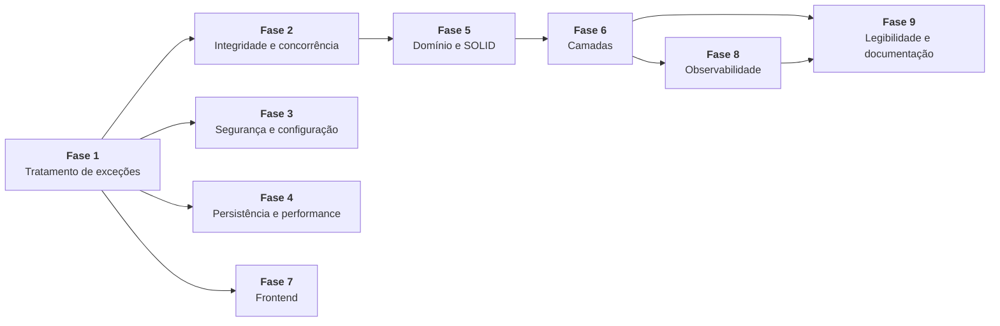

# HelpDesk Lite — Plano de Modernização

| Item | Valor |
|---|---|
| Branch | `refactoring` |
| Commit de referência | `c5f4335` |
| Data | 30/09/2026 |
| Entradas | [01-auditoria-tecnica.md](01-auditoria-tecnica.md) · [02-baseline-testes-caracterizacao.md](02-baseline-testes-caracterizacao.md) |
| Natureza | Planejamento. **Nenhum código foi alterado nesta etapa.** |

---

## 1. Princípios

1. **Incremental e reversível.** Um achado por commit, sempre com as suítes verdes. Nenhuma etapa deixa o sistema quebrado para a etapa seguinte consertar.
2. **Primeiro corrigir, depois reestruturar.** Os defeitos de comportamento (fases 1 a 3) são corrigidos antes das refatorações estruturais (fases 5 e 6). Assim, as refatorações partem de uma base correta, e cada tipo de mudança é revisado separadamente.
3. **Correção e refatoração nunca no mesmo commit.**
   - Um commit de **correção** (`fix`) muda comportamento, e por isso troca um teste de defeito por um de contrato.
   - Um commit de **refatoração** (`refactor`) não muda comportamento: os testes de contrato e de integração passam sem nenhuma edição.
4. **Sem funcionalidade nova, sem reescrita, sem *overengineering*.** Ficam fora do plano: arquitetura hexagonal, eventos de domínio, CQRS, MapStruct, Spring Security/JWT, troca de banco, novas rotas de negócio. Onde um achado só se resolveria com funcionalidade nova, o plano trata a parte corretiva e registra o resto como decisão do grupo (seção 14).
5. **Menor mudança suficiente.** Entre duas técnicas que resolvem o achado, vale a que toca menos arquivos e não muda o contrato HTTP.

---

## 2. Classificação dos achados

**Correção necessária** é todo achado que:
- produz **resposta incorreta**, **corrompe estado**, **expõe dado ou controle**; ou
- **viola uma regra de negócio ou do documento de arquitetura**; ou
- é pré-requisito técnico de outra correção.

**Melhoria opcional** é o que reduz custo de manutenção sem mudar o que o usuário ou o operador observam. Pode ser adiada ou descartada sem risco funcional.

| | Necessárias | Opcionais | Fora do escopo |
|---|---|---|---|
| Quantidade | 25 | 21 | 4 temas (decisão do grupo) |
| Exemplos | EXC-01, REG-01, REG-02, CON-01, CON-03, SEG-02, SEG-03, DOM-01, ARQ-01, FE-02 | DOM-06, CON-04, OBS-01, FE-03, EXC-02 | Reatribuição de chamado, reativação de cadastros, autenticação real, `acoesPermitidas` na API |

A classificação de cada item está nas tabelas das seções 5 a 13. As divergências DOC-01…10 contam como um item, e o par REG-06/REG-07 também. O TST-01 já foi tratado pela baseline do documento 02.

---

## 3. Ordem de execução



| Fase | Área | Objetivo | Natureza | Risco de regressão |
|:---:|---|---|---|:---:|
| 1 | Exceções | Respostas HTTP corretas e base para os 409/401 das fases seguintes | Correção | Baixo |
| 2 | Regras de negócio e concorrência | Fechar os caminhos que corrompem estado | Correção | Médio |
| 3 | Segurança e configuração | Padrão seguro, sem dado pessoal exposto | Correção | Baixo |
| 4 | Persistência e performance | Eliminar o N+1 | Correção (+ opcionais) | Baixo |
| 5 | Domínio, OO e SOLID | Agregado rico, regras num lugar só | Refatoração | **Alto** |
| 6 | Arquitetura em camadas | Restaurar `web → service → domain` | Refatoração | Médio |
| 7 | Frontend | Corrigir clique duplo, 401 e estado ambíguo; reduzir o CC 12 | Correção + refatoração | Baixo |
| 8 | Observabilidade | Métricas fiéis ao que foi gravado | Correção + opcionais | Baixo |
| 9 | Legibilidade e documentação | Código morto, duplicação, documentação coerente | Opcional + documentação | Muito baixo |

### Por que esta ordem

As dependências entre as fases são técnicas:

- **Fase 1 antes da 2.** O CON-01 precisa responder **409** quando houver conflito de versão, e o CON-02 precisa mapear `DataIntegrityViolationException`. Os dois dependem do handler corrigido na fase 1. Sem isso, a exceção nova cairia no catch-all e viraria 500.
- **Fase 2 antes da 5.** O teste de defeito do CON-01 usa `setStatus`/`setAtendente`. O DOM-01 remove esses setters. Por isso, o CON-01 é corrigido e seu teste é substituído antes que o DOM-01 os remova. Além disso, colocar `@Version` numa entidade estável é mais simples do que numa entidade em reestruturação.
- **Fase 5 antes da 6.** O ARQ-01 (mudar os tipos que os services recebem e devolvem) toca todas as assinaturas dos services. Fazer isso depois do domínio já estar no formato final evita mexer nas mesmas assinaturas duas vezes.
- **Fase 7 pode começar logo depois da fase 1.** O frontend só depende do contrato HTTP, que as fases 2 a 6 preservam. Se houver duas pessoas, a fase 7 roda em paralelo às fases 2 a 6.
- **Fase 8 depois da 6.** Mover a emissão de métricas para depois do commit (OBS-02) é mais simples quando os efeitos da transição já estão no agregado.
- **Fase 9 por último.** A documentação precisa descrever o código final.

---

## 4. Protocolo de cada passo

```
1. suítes verdes                    ./mvnw verify  e  npm test
2. (fix) escrever o teste de contrato com o comportamento CORRETO -> vermelho
3. alterar o código
4. (fix) apagar o teste [DEFEITO CONHECIDO <ID>] correspondente
5. suítes verdes; cobertura de linhas >= baseline (95,4% backend)
6. commit:  fix(<ID>): ...   ou   refactor(<ID>): ...
```

Há três formas legítimas de um teste de defeito sair da suíte:

| Forma | Quando | O que fazer |
|---|---|---|
| **Substituição** | O defeito foi corrigido | Apagar o teste de defeito e escrever o teste de contrato com o comportamento correto (passo 2) |
| **Reclassificação** | O grupo decide conscientemente manter o comportamento (seção 14) | Mover o teste para a suíte de contrato, renomeá-lo sem o rótulo e registrar a decisão numa ADR |
| **Adaptação de testes existentes** | Um teste antigo fixava o defeito sem rótulo (lista da seção 5 do documento 02) | Alterar no mesmo commit do `fix`, citando o ID |

Em um commit `refactor`, só é permitido editar testes **unitários** para acompanhar mudança de assinatura, pacote ou construtor. Os testes de **contrato** e de **integração** não podem ser editados. Se um deles precisar mudar, o commit não é uma refatoração.

---

## 5. Fase 1 — Tratamento de exceções

**Objetivo:** todo erro de cliente responde 4xx com o JSON padrão e log WARN. Deixar prontos os mapeamentos de 409 e 401 que as fases 2 e 3 vão usar.

| ID | Achado | Tipo | Técnica | Tamanho |
|---|---|---|---|:---:|
| EXC-01 | Erros de framework viram 500 | **Necessária** | *Substitute Algorithm* no handler: estender `ResponseEntityExceptionHandler`, sobrescrever `handleExceptionInternal` para devolver `ErroResponse` e manter o log WARN. Adicionar `@ExceptionHandler` para `PropertyReferenceException` (400), `DataIntegrityViolationException` (409) e `ObjectOptimisticLockingFailureException` (409). Remover o handler morto de `NoHandlerFoundException` | P |
| CON-02 | *Check-then-act* de unicidade acaba em 500 | **Necessária** | Coberto pelo mapeamento de `DataIntegrityViolationException` acima. A checagem prévia continua como caminho feliz | P |
| REG-04 | Login responde 422/404 onde o filter responde 401 | **Necessária** | *Introduce* `NaoAutenticadoException` → 401 `NAO_AUTENTICADO`; o `UsuarioService.autenticar` passa a lançá-la | P |
| SEG-06 | Mensagem do 401 revela se o usuário existe | **Necessária** | Mensagem genérica no corpo; o detalhe vai só para o log WARN. Feito junto com o REG-04, porque é a mesma mensagem | P |
| EXC-04 | `ErroResponse` usa `Instant.now()` | Opcional | *Introduce Parameter*: o handler e o filter recebem o `Clock` | P |

**Decisão de contrato:** o código de erro para 409 será `CONFLITO`. Os códigos para 405 e 415 seguem o padrão existente (`METODO_NAO_SUPORTADO`, `MIDIA_NAO_SUPORTADA`). O JSON de erro continua com os mesmos quatro campos.

**Testes que protegem a mudança**
- **Contrato, não podem mudar:** `ChamadoControllerTest` (400/401/403/404/422 e formato do erro) e as rotas de erro de `CadastrosApiIT`.
- **Defeitos a substituir:**
  - `DefeitosConhecidosIT.Exc01` (5 testes) → novos testes de contrato para 404, 405, 415 e 400, mais "4xx logado em WARN";
  - `Reg04` (2) e `mensagemDo401RevelaExistencia` → 401 com mensagem genérica.
- **Testes existentes a adaptar no mesmo commit:**
  - `UsuarioServiceTest.deveRecusarLoginDeUsuarioInativo/Inexistente` (tipo da exceção);
  - `ChamadoControllerTest.deveDevolver401QuandoOUsuarioEstaInativo` (a mensagem deixa de conter "inativo").
- **Novo teste:** mapeamento de `DataIntegrityViolationException` → 409, simulado num `@WebMvcTest` com o service lançando a exceção. Resolve a lacuna do CON-02 apontada no documento 02.

**Aceite:** nenhuma requisição de cliente malformada produz log ERROR.

---

## 6. Fase 2 — Regras de negócio e concorrência

**Objetivo:** fechar os caminhos que deixam o sistema em estado inválido, **aplicando as regras que já existem** (I3 e I10) em vez de criar novas.

| ID | Achado | Tipo | Técnica | Tamanho |
|---|---|---|---|:---:|
| REG-01 | O sistema pode ficar sem nenhum admin | **Necessária** | *Introduce Guard Clause* em `UsuarioService.atualizar` e `desativar`: 422 se a operação deixar zero admins ativos. Nova consulta derivada `countByPerfilAndAtivoTrue` | P |
| REG-02 | Atendente rebaixado ou desativado deixa o chamado órfão | **Necessária** | *Introduce Guard Clause*: 422 ao rebaixar para SOLICITANTE, ou ao desativar, um usuário que é atendente de chamado `EM_ATENDIMENTO` **ou `RESOLVIDO`** (um chamado resolvido pode ser reaberto e voltar para ele). Nova consulta `existsByAtendenteIdAndStatusIn`. **Não** cria reatribuição (seção 14) | P |
| CON-01 | Sem lock otimista | **Necessária** | *Add field* `@Version Long versao` em `Chamado`. O 409 já vem mapeado da fase 1. Coluna nova com valor inicial: o `data.sql` recebe `versao = 0` | P |

**Testes que protegem a mudança**
- **Contrato, não podem mudar:**
  - `ChamadoContratoApiIT.Atribuicao`, `CicloDeVidaChamadoIT` e `ChamadoServiceTest.Assumir` (o fluxo normal de assunção continua igual);
  - `CadastrosApiIT.Usuarios` (atualizar e desativar usuários sem chamados continua funcionando);
  - `UsuarioServiceTest.deveImpedirQueOAdminDesativeOProprioUsuario` (I10).
- **Defeitos a substituir:**
  - `unicoAdminPodeRebaixarASiMesmo` → contrato "rebaixar o último admin ativo devolve 422";
  - `Reg02` (2) → contrato "rebaixar ou desativar atendente com chamado em andamento devolve 422, e o chamado continua com ele";
  - `ultimaEscritaVenceSemLockOtimista` → contrato "gravar uma cópia desatualizada lança `ObjectOptimisticLockingFailureException`". Escrito **sem setters** (usando o service ou o builder), para sobreviver ao DOM-01.
- **Novos testes unitários:** as guardas de REG-01 e REG-02 em `UsuarioServiceTest`, com a consulta mockada, incluindo o caso limite "dois admins, rebaixar um é permitido".

**Risco:** a coluna `versao` muda o schema. Em `dev` e `test` o banco é recriado a cada boot. Em `prod` (`ddl-auto: validate`) será preciso um script de migração, que deve ser registrado na documentação (fase 9).

---

## 7. Fase 3 — Segurança e configuração

**Objetivo:** o artefato padrão é seguro, nenhuma rota pública expõe dado pessoal e o log não carrega e-mail. **A autenticação simulada (ADR-003) permanece.**

| ID | Achado | Tipo | Técnica | Tamanho |
|---|---|---|---|:---:|
| SEG-02 | O perfil padrão é `dev`: Actuator aberto | **Necessária** | Remover `spring.profiles.default: dev`. O `dev` fica explícito no `spring-boot:run` (configuração do plugin) e no README. Tirar `env` e `loggers` da exposição em `dev` | P |
| TST-02 | O `@WebMvcTest` sobe em `dev` | **Necessária** (efeito do SEG-02) | `@ActiveProfiles("test")` em `ChamadoControllerTest` | P |
| SEG-03 | Rota pública expõe e-mail | **Necessária** | *Substitute*: `listarDisponiveisParaLogin` passa a usar `UsuarioResumoResponse`, que já existe. O frontend de login só usa id, nome e perfil (conferir no passo) | P |
| SEG-04 | E-mail em log WARN | **Necessária** | Mensagem da `RegraNegocioException` sem o e-mail ("Ja existe um usuario com este e-mail"). É a menor mudança possível e não cria infraestrutura de mascaramento | P |
| SEG-01 | Autenticação simulada ativa em `prod` | **Necessária** (parte mínima) | *Fail-fast*: propriedade `helpdesk.auth.simulada` (padrão `true`); no perfil `prod`, a aplicação não sobe se ela estiver `true`. **Não** implementa JWT | P |
| SEG-05 | `X-Request-Id` sem validação | Opcional | Aceitar só `^[A-Za-z0-9-]{1,64}$`; senão, gerar um UUID | P |
| SEG-07 | `sort` livre | Opcional | Lista branca no controller. O 400 do campo inválido já existe desde a fase 1 | P |

**Testes que protegem a mudança**
- **Contrato, não podem mudar:**
  - `CadastrosApiIT.Login` (lista só ativos, login funciona);
  - `CicloDeVidaChamadoIT.deveExporOLoginSimuladoSemAutenticacao`;
  - `ChamadoControllerTest.devePropagarORequestIdDoCliente` (um id válido continua sendo reaproveitado);
  - `authStore.spec.js` (o frontend lê o login).
- **Defeitos a substituir:**
  - `rotaPublicaExpoeEmail` → contrato "a rota pública não tem o campo `email`";
  - `emailApareceNoLog` → contrato "o 422 de e-mail duplicado não loga o e-mail".
- **Novos testes:**
  - teste de contexto verificando que o perfil `prod` com a autenticação simulada ligada falha na inicialização;
  - `X-Request-Id` malformado é substituído (se o SEG-05 for feito).

**Atenção:** o SEG-03 muda o contrato de uma rota. Antes do commit, conferir com `grep` que o frontend não lê `email` dessa resposta. `LoginPage.vue` mostra nome e perfil.

---

## 8. Fase 4 — Persistência e performance

| ID | Achado | Tipo | Técnica | Tamanho |
|---|---|---|---|:---:|
| CON-03 | N+1 na listagem | **Necessária** | Sobrescrever `findAll(Specification, Pageable)` em `ChamadoRepository` com `@EntityGraph(attributePaths = {"categoria","solicitante","atendente"})`. Todas são `@ManyToOne`, então não há produto cartesiano nem paginação em memória | P |
| REG-05 | Consulta feita só para o log | Opcional | *Inline*/remoção de `existsByCategoriaId` em `desativar` | P |
| CON-04 | Dashboard carrega a base inteira | Opcional | *Substitute Algorithm*: `GROUP BY` para as contagens. A lista "fora do SLA" continua em Java sobre os chamados em andamento ou resolvidos fora do prazo. Fazer **só** se houver volume que justifique; hoje não há | M |
| CON-05 | `RESTART WITH` fixo no seed | Opcional | Calcular o valor com `SELECT MAX(id)+1` no próprio script, ou documentar a regra no topo do arquivo | P |

**Testes que protegem a mudança**
- **Contrato, não podem mudar:**
  - `ChamadoSpecificationTest` (visibilidade no `WHERE` e no `count`);
  - `ChamadoContratoApiIT.FormatoDoJson` (formato e ordem da listagem);
  - `DashboardServiceTest` e `CadastrosApiIT.Dashboard`.
- **Defeito a substituir:** `listagemFazNMaisUm` → contrato "listar faz 2 consultas, qualquer que seja o número de chamados". O teste passa a usar 3 **e** 10 chamados, para provar que a contagem não cresce.
- **Cuidado:** o `@EntityGraph` não pode mudar o `count` da paginação. `deveAplicarAVisibilidadeTambemNaContagemDePaginas` cobre isso.

---

## 9. Fase 5 — Domínio, Orientação a Objetos e SOLID

**Objetivo:** as regras do chamado ficam no agregado e as de domínio ficam no pacote `domain`, **sem mudar nenhum comportamento**. É a fase de maior risco, porque toca o núcleo. Por isso é feita em passos pequenos, na ordem abaixo.

| Passo | ID | Achado | Tipo | Técnica | Tamanho |
|:---:|---|---|---|---|:---:|
| 5.1 | DOM-01 | `Chamado` anêmico, com setters públicos | **Necessária** | Em sequência: (a) *Replace Constructor with Factory Method*: `Chamado.abrir(...)`; (b) *Move Method*: `assumir(atendente, agora)`, `alterarStatus(novo, agora)` movidos de `ChamadoService` para `Chamado`; (c) *Remove Setting Method* nos campos de estado. **Mantém** `@Getter` e o `@Builder`, usado só na reconstituição (testes e JPA) | M |
| 5.2 | DOM-02 | Efeitos da transição separados da tabela | **Necessária** | *Move Method*: o `switch` de carimbos sai do service e vira um método privado de `Chamado`, chamado por `alterarStatus`. A **tabela** `TransicaoStatus` continua sendo a única fonte de "quem pode ir para onde". Não se cria um padrão State | P |
| 5.3 | DOM-03 | *Type code* `perfil == X` | **Necessária** | *Replace Type Code with Polymorphism*, na forma leve: métodos de capacidade em `Perfil` (`enxergaTodosOsChamados()`, `gerenciaCadastros()`, `atendeChamados()`), usados por `PermissaoService` e `ChamadoSpecification`. Remove os `Usuario.isX()` não usados | P |
| 5.4 | ARQ-03 | Regra de visibilidade triplicada | **Necessária** | *Consolidate Duplicate Conditional Fragments*: `verificarComentario` delega a `verificarVisualizacao`. A `Specification` passa a usar `perfil.enxergaTodosOsChamados()` do passo 5.3, a mesma pergunta do `PermissaoService` | P |
| 5.5 | DOM-04 | `verificarAbertura` vazio; parâmetro morto | Opcional | *Remove Parameter*; *Inline Method* | P |
| 5.6 | ARQ-02 | `SlaCalculator` e `PermissaoService` fora do `domain` | Opcional | *Move Class* para `domain.sla` e `domain.permissao`, sem `@Service`, expostos pelo `DominioConfig`, como já acontece com a `TransicaoStatus` | P |
| 5.7 | ARQ-04 | SLA calculado no mapper | Opcional | *Extract Method*: `SlaCalculator.situacao(chamado)` devolve um `record SituacaoSla(prazo, foraDoSla, atraso)`. O mapper e o dashboard passam a chamá-lo uma vez por chamado | P |
| 5.8 | DOM-06 | `ChamadoService` com 9 dependências | Opcional | *Extract Class*: `ComentarioService` (comentar e listar). **Não** introduz eventos de domínio | P |

**Como o passo 5.1 preserva a ordem 403 → 422:** o service continua fazendo `buscar → permissaoService.verificar...(403)`. Só depois chama `chamado.assumir(...)`/`alterarStatus(...)`, que valida contra a `TransicaoStatus` (422). A ordem fica explícita no service, e o agregado não conhece permissão.

**Testes que protegem a mudança**
- **Contrato e domínio, não podem mudar:**
  - `TransicaoStatusTest` (a tabela);
  - `PermissaoServiceTest` (só o import muda no passo 5.6);
  - `SlaCalculatorTest`;
  - `ChamadoContratoApiIT` (formato, atribuição, auditoria);
  - `CicloDeVidaChamadoIT` e `ChamadoSpecificationTest`.
- **`ChamadoServiceTest`:** continua passando. A verificação de ordem (`InOrder` permissão → transição) é a principal proteção do 403 → 422. Se o passo 5.1 mudar o ponto em que a `TransicaoStatus` é chamada, o `spy` continua detectando.
- **Adaptações permitidas** (só compilação):
  - `ChamadoSpecificationTest:85` troca `setResolvidoEm` pelo `ChamadoBuilder`;
  - no passo 5.6, os imports de 5 testes unitários que fazem `new PermissaoService(...)`.
- **Novo teste unitário:** `ChamadoTest`, com as transições pelo agregado (abrir, assumir, resolver, fechar, reabrir, e transição inválida lançando `TransicaoInvalidaException`), sem Spring e sem mocks.
- **Nenhum teste de defeito é substituído** nesta fase, porque ela não corrige comportamento. Se algum teste de defeito quebrar, a fase mudou comportamento por acidente: reverter.

---

## 10. Fase 6 — Arquitetura em camadas

| ID | Achado | Tipo | Técnica | Tamanho |
|---|---|---|---|:---:|
| ARQ-01 | `service` depende de `web.dto` | **Necessária** (contraria o §4.1 documentado) | Em sequência: (a) *Move Class*: os `*Response` e os mappers vão para `service.dto` e `service.mapper`, e a web passa a importá-los (direção permitida); (b) *Introduce Parameter Object*: os services recebem *records* de comando próprios (`AbrirChamadoCommand` e similares), e o controller converte Request → Command. Os `*Request`, com Bean Validation, ficam na web | M |
| EXC-02 | Exceções sem hierarquia comum | Opcional | *Extract Superclass*: `DominioException(codigo)`. O handler mapeia código → status num único método, substituindo os 4 métodos quase iguais | P |

**Por que os Responses não são convertidos no controller:** com `open-in-view: false`, converter uma entidade fora da transação do service dispararia `LazyInitializationException`. Mover os tipos de pacote resolve a direção da dependência sem mudar **onde** a conversão acontece. É a menor mudança segura.

**Testes que protegem a mudança**
- **Contrato, não podem mudar:** `CadastrosApiIT`, `ChamadoContratoApiIT`, `CicloDeVidaChamadoIT` e `ChamadoControllerTest`. Nenhum campo do JSON pode mudar.
- **Adaptações permitidas:** os imports dos 4 testes unitários de service que usam `web.dto`.
- **Verificação estrutural nova:** um teste que falha se qualquer classe de `br.com.helpdesk.service` ou `br.com.helpdesk.domain` importar `br.com.helpdesk.web`. Pode ser feito com reflexão sobre o classpath, sem incluir ArchUnit, para não trazer dependência nova. Esse teste impede a regressão do ARQ-01.

---

## 11. Fase 7 — Frontend

A fase 7 pode rodar em paralelo às fases 2 a 6 (seção 3).

| ID | Achado | Tipo | Técnica | Tamanho |
|---|---|---|---|:---:|
| FE-02 | A proteção contra clique duplo não funciona | **Necessária** | O `ChamadoAcoes` recebe `processando` como prop controlada pelo pai (a página), que faz `await` na store. *Move Field*: o estado sai do componente, que não tem como saber quando a requisição termina | P |
| EXC-03 | 401 não encerra a sessão; erros tratados de forma inconsistente | **Necessária** | No interceptor, o 401 chama o `sair()` do authStore (por um callback registrado, para não criar import circular) e redireciona para `/login`. Trocar os 10 `.catch(() => {})` e os `await` sem `catch` por um padrão único nas páginas | P |
| FE-04 | Lista de categorias com semântica ambígua | **Necessária** | *Split Variable*: `categoriasAtivas` e `todasCategorias` no `catalogoStore`, com um estado de carregamento por recurso | P |
| FE-01 | CC 12 e máquina de estados duplicada | **Necessária** (único método com CC > 10) | *Replace Conditional with Table*: uma tabela declarativa `[{ status, acao, para, perfis, exigeRelacao }]`, espelho da `TransicaoStatus`, avaliada por um único `filter`. CC esperado ≤ 4. **Não** muda a API (a alternativa de o backend devolver `acoesPermitidas` fica registrada na seção 14) | P |
| FE-03 | Constantes e formatação duplicadas | Opcional | *Extract Module*: `src/constants/dominio.js` e `src/utils/formatacao.js`. Unifica o rótulo "Administrador" | P |
| FE-05 | Fallback da URL duplicado; `$api` morto | Opcional | *Remove Dead Code*; fallback num lugar só | P |
| FE-06 | Formatos misturados na lista | Opcional | Copiar só os campos do resumo em `aplicarAtualizacao` | P |
| FE-07 | Toggle "Somente os meus" inútil para o solicitante | Opcional | Esconder o toggle quando o perfil é SOLICITANTE | P |
| SEG-08 | Perfil desatualizado no `localStorage` | Opcional | Com o EXC-03, um usuário desativado já é deslogado no primeiro 401. Para o perfil alterado, revalidar a sessão ao iniciar a aplicação chamando o `POST /auth/login` **que já existe** com o id salvo. Nenhuma rota nova | P |
| TST-03 | Sem métrica de cobertura | Opcional | `@vitest/coverage-v8` no script `test:coverage`, sem meta obrigatória | P |

**Testes que protegem a mudança**
- **Contrato, não podem mudar:**
  - `ChamadoAcoes.spec.js` (18 testes da matriz perfil × status × relação). É a proteção do FE-01: a tabela nova tem de produzir exatamente os mesmos botões;
  - `api.spec.js` (headers e tradução de erro);
  - `chamadosStore.spec.js` e `authStore.spec.js`.
- **Defeitos a substituir:**
  - `ChamadoAcoesProcessando.spec.js` (2) → "desabilitado enquanto `processando`" e "um clique, uma emissão";
  - o teste EXC-03 em `api.spec.js` → "401 limpa a sessão";
  - o teste FE-04 em `catalogoStore.spec.js` → "salvar não altera `categoriasAtivas`".
- **Adaptação permitida:** o `catalogoStore.spec.js` acompanha a troca de nome do estado (FE-04), no mesmo commit do `fix`.
- **Verificação:** rodar o `lizard` de novo e confirmar que nenhuma função passa de CC 10.

---

## 12. Fase 8 — Observabilidade

| ID | Achado | Tipo | Técnica | Tamanho |
|---|---|---|---|:---:|
| OBS-02 | Métrica registrada antes do commit e duplicada na reabertura | **Necessária** (a métrica diverge do que foi gravado) | Registrar as métricas de transição em `TransactionSynchronization.afterCommit`, a partir do service. Não precisa de eventos | P |
| OBS-03 | Formato de auditoria inconsistente | Opcional | *Extract Class*: um componente `Auditoria` com um formato único (`acao`, `alvo`, `alvoId`, `perfil`, `detalhes`) | P |
| OBS-01 | Gauges só atualizam na leitura do dashboard | **Opcional, com decisão** | Duas saídas: (a) manter a ADR-018 e **reclassificar** o teste de defeito como contrato; ou (b) `@Scheduled` a cada 5 minutos reaproveitando as consultas do dashboard, revisando a ADR-018. Recomendação: **(a)**, porque o MVP não tem Prometheus configurado | P |

**Testes que protegem a mudança**
- **Contrato, não podem mudar:** `ChamadoContratoApiIT.Auditoria` para as linhas de auditoria do chamado. Se o OBS-03 mudar o formato, isso é mudança de contrato de log e deve ser feito como `fix` explícito, atualizando o §4.11.
- `MetricasNegocioTest` e `DashboardServiceTest`.
- **Novo teste:** num teste de integração, uma transição que falha depois de validada (por exemplo, por conflito de versão) não pode incrementar o contador.
- **Defeito:** `gaugeSoAtualizaNaLeituraDoDashboard` é reclassificado (opção a) ou substituído (opção b).

---

## 13. Fase 9 — Legibilidade e documentação

| ID | Achado | Tipo | Técnica |
|---|---|---|---|
| DOM-05 | Código morto | Opcional | *Remove Dead Code*. Não remover o que outra fase tenha passado a usar (por exemplo, `TransicaoInvalidaException.getDe/getPara`, se a fase 1 incluí-los no corpo do 422) |
| REG-06 / REG-07 | Normalização duplicada; `trim()` inalcançável no e-mail | Opcional | *Extract Method*: `normalizarEmail` e `garantirNomeUnico`. Para o REG-07, decidir entre remover o `trim()` morto ou aparar o valor antes da validação. Se o comportamento mudar, `CadastrosApiIT.deveReprovarEmailComEspacosAntesDoTrim` é atualizado num `fix` |
| REG-03 | Javadoc promete uma reativação inexistente | **Necessária** (a documentação mente) | Corrigir o comentário de `CategoriaService`. Reclassificar o teste de defeito REG-03 como contrato ("`PUT` não altera `ativa`"), a menos que o grupo aprove a funcionalidade (seção 14) |
| DOC-01…10 | Divergências entre documentação e código | **Necessária** | Consolidar as ADRs em `docs/adr/` (001–018, mais as ADRs novas deste plano: 409 de conflito, perfil padrão, guardas de REG-01/02) e atualizar §4.1, §4.8, §4.10, §4.11 e §6 do `ARQUITETURA.md`, e as regras I3/I9 |
| — | Relatório final | **Necessária** | `04-relatorio-modernizacao.md`: antes × depois (achados resolvidos, métricas, testes), com a comparação `main` × `refactoring` |

---

## 14. Fora do escopo: decisões do grupo

Estes pontos só se resolveriam com **funcionalidade nova**, o que a atividade exclui. O plano entrega a parte corretiva e deixa a decisão registrada.

| Tema | Achado | O que o plano faz | O que ficaria para depois |
|---|---|---|---|
| Reatribuição de chamado | REG-02 | Impede a criação do chamado órfão (guarda) | Rota para o admin trocar o atendente |
| Reativação de categoria e usuário | REG-03 | Corrige o comentário que prometia a reativação e reclassifica o teste | Rotas `PATCH .../reativar` |
| Autenticação real | SEG-01 | *Fail-fast* em `prod` | Spring Security + JWT/OIDC, previsto na ADR-003 |
| `acoesPermitidas` na API | FE-01 | Tabela declarativa no frontend | O backend calcula as ações e o frontend só as exibe |

---

## 15. Riscos e mitigação

| Risco | Onde | Mitigação |
|---|---|---|
| Inverter a ordem 403 → 422 ao mover a transição para a entidade | Fase 5.1 | `ChamadoServiceTest.deveChamarPermissaoEDepoisTransicaoNaOrdem` (InOrder) e `CicloDeVidaChamadoIT.deveAplicarPermissaoEDepoisTransicaoNaApi`. A ordem fica escrita no service |
| `LazyInitializationException` ao mover DTOs e mappers | Fase 6 | A conversão continua dentro da transação do service; os testes de integração cobrem cada rota |
| O `@EntityGraph` mudar a contagem de páginas | Fase 4 | `ChamadoSpecificationTest` (visibilidade no `count`) |
| Schema de `prod` com `ddl-auto: validate` | Fase 2 (`versao`) | Script SQL documentado na fase 9 |
| Mudança de contrato não percebida | Todas | Os testes de contrato não podem ser editados em `refactor` (seção 4) |
| Duplicar a regra de transição no frontend (FE-01 mantém um espelho) | Fase 7 | Tabela comentada com referência à `TransicaoStatus`; a matriz de 18 testes cobre toda divergência visível |

---

## 16. Critérios de conclusão da modernização

1. Todos os achados **necessários** tratados, ou reclassificados com justificativa (seção 14).
2. **Zero testes `[DEFEITO CONHECIDO]`** na suíte. Cada um foi substituído por um teste de contrato ou reclassificado com uma ADR.
3. Suítes verdes; cobertura de linhas do backend ≥ 95,4%; nenhuma função com CC > 10.
4. Nenhum teste de contrato criado no documento 02 foi editado em commit `refactor`.
5. Documentação coerente com o código (DOC-01…10), com as ADRs consolidadas.
6. `main` intacta em `c5f4335`, para a comparação final.
